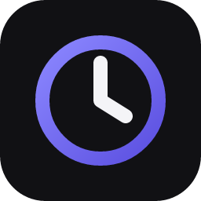
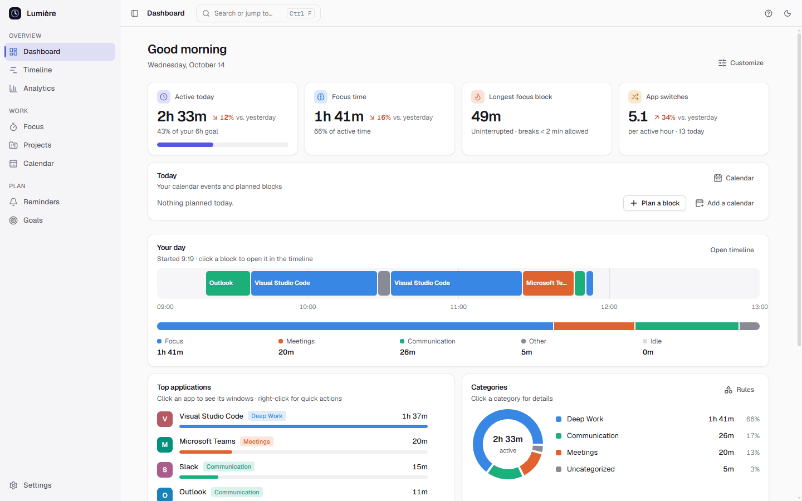
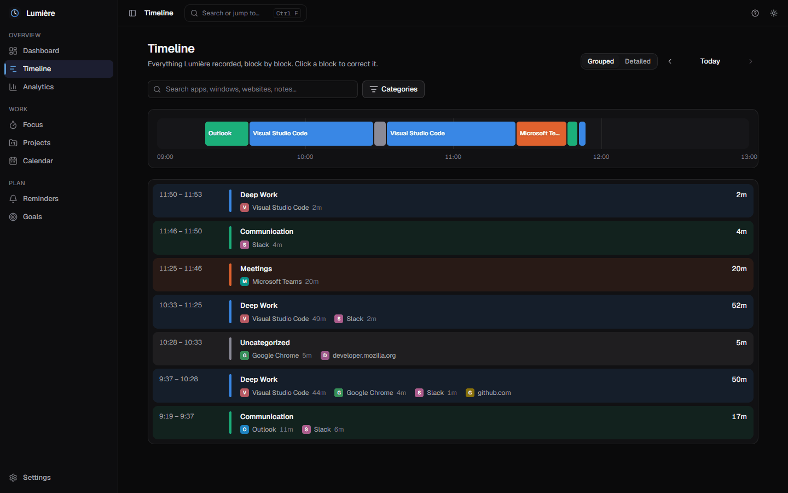
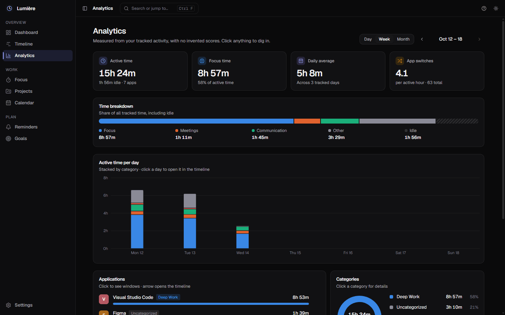
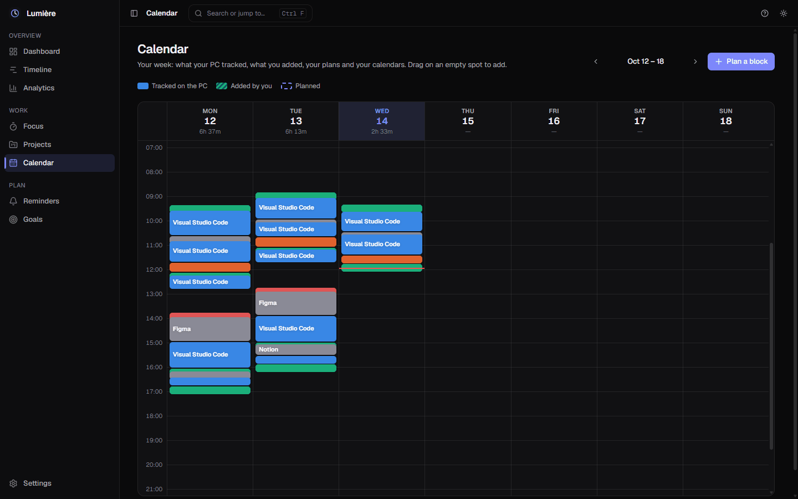
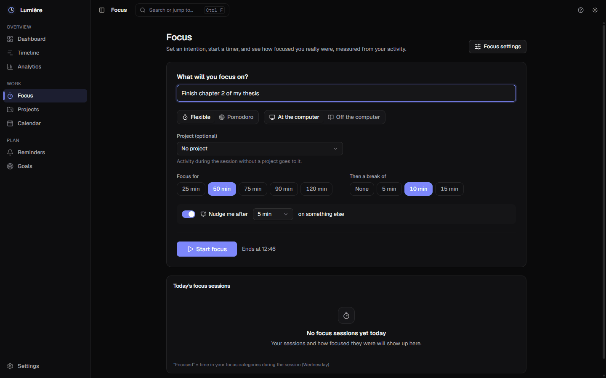

# Lumière

### Your time, seen clearly. Private by design.

A **free, offline time tracker for Windows**. Lumière quietly notes which app and website you're
using, so you can see where your day really went, without an account, a cloud or AI.

 

<picture>
  <source media="(prefers-color-scheme: dark)" srcset="assets/dashboard-dark.png">
  
</picture>

---

## ✨ What Lumière does

| | |
|---|---|
| 🕒 **Tracks automatically** | Notes the app and website in front of you, every second. It knows when you're away, and when you're just watching a video or in a call. |
| 📊 **Shows your day clearly** | A dashboard, a timeline and weekly analytics: active time, focus time, top apps, sites and categories. Click anything to dig in. |
| 🎯 **Helps you focus** | A focus timer or Pomodoro, with a gentle nudge when you drift to something else. |
| 📅 **Fits your calendar** | Plan blocks, add what you did offline, and see your Google Calendar events (read-only) with reminders. |
| 🗂️ **Organizes for you** | Categories and projects filled in by your own simple rules, plus daily or weekly goals. |
| 🧳 **Keeps work and life apart** | Separate *Private* and *Pro* spaces, switched by hand or on a schedule. |
| 🔄 **Stays up to date** | New versions are offered in the app and install in one click. Your data can be exported anytime. |

<table>
  <tr>
    <td width="50%">
<b>Timeline</b>: every block of your day, searchable
</td>
    <td width="50%">
<b>Analytics</b>: your week by category
</td>
  </tr>
  <tr>
    <td width="50%">
<b>Calendar</b>: tracked time, plans and events
</td>
    <td width="50%">
<b>Focus</b>: set an intention, start a timer
</td>
  </tr>
</table>

## 🔒 Privacy first

- 💾 **Everything stays on your PC**, in a single file. No account, no cloud, no telemetry.
- 🙈 **Never recorded:** what you type, screenshots, screen contents, full web addresses (only the
  site name, like `github.com`) and private/incognito windows. Window titles can be turned off.
- 🌐 **Internet is used for two things only:** calendar links you add yourself, and a small daily
  update check, which you can turn off in **Settings → About**. Nothing about you is ever sent.
- 🚫 **No AI.** Only fixed, transparent rules that you control.

## 📥 Install in 1 minute

1. **Download** `Lumiere_<version>_x64-setup.exe` from the [latest release](https://github.com/Jata1313/Lumiere-releases/releases/latest) (about 3 MB).
2. **Run it.** It installs for your Windows user only, with no admin rights needed.
3. If Windows shows **"Windows protected your PC"**, click **More info → Run anyway**.
   This appears because Lumière isn't signed with a paid certificate yet; the updates themselves are
   cryptographically signed.

A short introduction guides you on first launch. Closing the window keeps Lumière tracking from the
tray (next to the clock); right-click its icon → **Quit Lumière** to stop it.

## 🔄 Updates

Lumière checks once a day for a new version and shows **"Update available"**. Nothing installs
until you click. Every update is signed, and Lumière refuses any file that wasn't signed by its
developer. See what changed in **Settings → About → What's new**.

## ❓ FAQ

<b>Is it really free?</b>

 
Yes. No subscription, no ads, no premium tier.

<b>Where is my data, and how do I back it up?</b>

 
In <code>%APPDATA%\app.lumiere.desktop</code>. Lumière backs it up automatically every day and before
any change to how it's stored. You can also export a spreadsheet or a full copy in <b>Settings → Data &amp; privacy</b>.

<b>Does it work on Mac or Linux?</b>

 
Windows 10 and 11 for now. A Mac version is in progress; Linux may come later.

<b>How do I uninstall it?</b>

 
Windows Settings → Apps → Installed apps → Lumière → Uninstall. The uninstaller asks whether to
delete your data too; if you keep it, it's there if you come back.

<b>Why isn't the source code here?</b>

 
Lumière is still in beta. The code will be published as open source once it's ready; this
repository only holds the installers and the signed update files.

## 🐞 Found a bug or have an idea?

[**Open an issue**](https://github.com/Jata1313/Lumiere-releases/issues/new/choose). For a bug, it
helps a lot to paste the report from **Settings → About → Diagnostic info → Copy**: it contains
versions and error messages only, never your activity, apps or websites.

## 🗺️ Roadmap

- [x] Automatic tracking, dashboard, timeline, analytics
- [x] Focus sessions, calendar, goals, reminders, spaces
- [x] One-click signed updates, data export, diagnostics
- [ ] 🍎 macOS version
- [ ] 🇫🇷 French translation
- [ ] 🔓 Open source code
- [ ] 🌍 Website

 
Made with ☀️ by <a href="https://github.com/Jata1313">Jata1313</a>, built with Claude.

